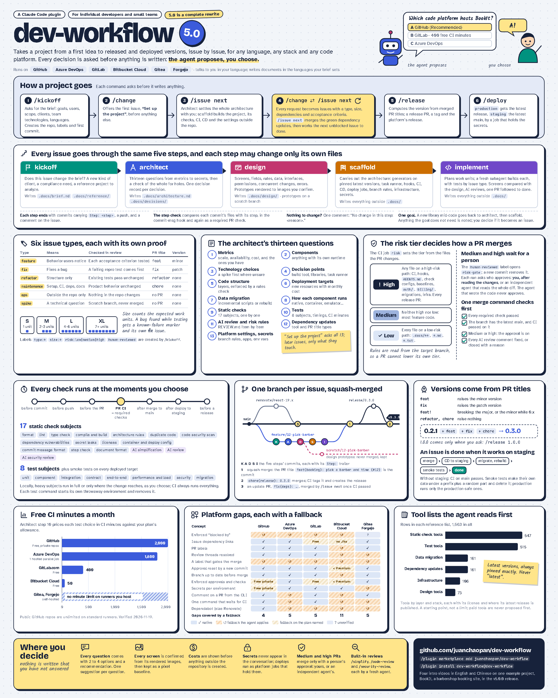

# dev-workflow

A Claude Code plugin that takes a project from a first idea to released and deployed versions, for any language, any stack and any code platform (GitHub, Azure DevOps, GitLab, Bitbucket Cloud, Gitea and Forgejo). It is made for individual developers and small teams.

It works issue by issue. Every issue goes through the same five steps, and every decision is asked before anything is written: the agent proposes, you choose.

The plugin is written in English. It talks to you in your language, and writes the project's documents, screens and issues in the languages the project brief sets.

## Poster

A one-page overview of 5.0: how a project goes from `/kickoff` to `/deploy`, the five steps of an issue, the issue types, the architect's thirteen questions, risk tiers and merging, check timings, branches, versions, and how each code platform's gaps are covered. Click it for full size, or take the [PDF](https://github.com/juanchaopan/dev-workflow/releases/download/v5.0.0/dev-workflow-5-poster.pdf) to zoom in.

[](docs/poster.png)

## Introduction videos

Four episodes, one per level, all built on the same example project: BookIt, an online booking site for a barbershop. Each comes in Chinese and English, landscape and portrait, with burned-in subtitles. The subtitle files and cover images are in the [5.0.0 release](https://github.com/juanchaopan/dev-workflow/releases/tag/v5.0.0).

| Episode | Level | English | Chinese |
|---|---|---|---|
| 1 | From an idea to production | [landscape](https://github.com/juanchaopan/dev-workflow/releases/download/v5.0.0/dev-workflow-5-ep1-en-landscape.mp4) · [portrait](https://github.com/juanchaopan/dev-workflow/releases/download/v5.0.0/dev-workflow-5-ep1-en-portrait.mp4) (5:56) | [横屏](https://github.com/juanchaopan/dev-workflow/releases/download/v5.0.0/dev-workflow-5-ep1-zh-landscape.mp4) · [竖屏](https://github.com/juanchaopan/dev-workflow/releases/download/v5.0.0/dev-workflow-5-ep1-zh-portrait.mp4) (5:31) |
| 2 | When requirements change | [landscape](https://github.com/juanchaopan/dev-workflow/releases/download/v5.0.0/dev-workflow-5-ep2-en-landscape.mp4) · [portrait](https://github.com/juanchaopan/dev-workflow/releases/download/v5.0.0/dev-workflow-5-ep2-en-portrait.mp4) (3:27) | [横屏](https://github.com/juanchaopan/dev-workflow/releases/download/v5.0.0/dev-workflow-5-ep2-zh-landscape.mp4) · [竖屏](https://github.com/juanchaopan/dev-workflow/releases/download/v5.0.0/dev-workflow-5-ep2-zh-portrait.mp4) (3:10) |
| 3 | Quality and review | [landscape](https://github.com/juanchaopan/dev-workflow/releases/download/v5.0.0/dev-workflow-5-ep3-en-landscape.mp4) · [portrait](https://github.com/juanchaopan/dev-workflow/releases/download/v5.0.0/dev-workflow-5-ep3-en-portrait.mp4) (4:33) | [横屏](https://github.com/juanchaopan/dev-workflow/releases/download/v5.0.0/dev-workflow-5-ep3-zh-landscape.mp4) · [竖屏](https://github.com/juanchaopan/dev-workflow/releases/download/v5.0.0/dev-workflow-5-ep3-zh-portrait.mp4) (4:17) |
| 4 | Production grade | [landscape](https://github.com/juanchaopan/dev-workflow/releases/download/v5.0.0/dev-workflow-5-ep4-en-landscape.mp4) · [portrait](https://github.com/juanchaopan/dev-workflow/releases/download/v5.0.0/dev-workflow-5-ep4-en-portrait.mp4) (4:13) | [横屏](https://github.com/juanchaopan/dev-workflow/releases/download/v5.0.0/dev-workflow-5-ep4-zh-landscape.mp4) · [竖屏](https://github.com/juanchaopan/dev-workflow/releases/download/v5.0.0/dev-workflow-5-ep4-zh-portrait.mp4) (3:50) |

## Installation

In Claude Code:

```
/plugin marketplace add <owner>/<repository>
/plugin install dev-workflow@dev-workflow
```

Or clone the repository into `~/.claude/skills/dev-workflow/`. Commands such as `/kickoff` work directly; when another plugin uses the same name, write `/dev-workflow:kickoff`.

To update, run `/plugin marketplace update dev-workflow` (or `git pull` in the clone), then start a new Claude Code session.

## Commands

| Command | What it does |
|---|---|
| `/kickoff` | Starts a project: the brief, the code platform, the repository, the labels and the first commit |
| `/change` | Turns what you say into issues, each with a type, a size, dependencies, a goal, scope and acceptance criteria; also the analysis of a reference project |
| `/issue <number>` | Works that issue from where it stands to done |
| `/issue next` | Merges the dependency updates that passed CI, then picks the next issue that can start and works it to done |
| `/kickoff <n>`, `/architect <n>`, `/design <n>`, `/scaffold <n>`, `/implement <n>` | Runs one step of an issue |
| `/release` | Computes the version and releases it through a release PR, a tag and the platform's release |
| `/deploy <target>` | Deploys a target from the architecture: production gets the latest release, staging the latest `main` |
| `/perf-test <target>` | Runs the load tests against a deployment target |

## How a project goes

1. `/kickoff` asks for the brief: goals, users, scope, clients, the team's technologies, reference projects, languages, the code platform and the first version. It creates the repository with `.docs/brief.md` and `VERSION`.
2. `/change` offers the first issue, "Set up the project". `/issue next` works it: the architect step settles the whole architecture with you, and the scaffold step builds the project, its checks, CI, CD and the settings outside the repository.
3. From then on, `/change` turns each request into issues, and `/issue next` works them one at a time.
4. `/release` cuts a version; `/deploy production` puts it into production.

Each issue goes through five steps, each allowed to change only its own files:

| Step | What it settles | Writes |
|---|---|---|
| kickoff | Whether the brief changes; the analysis of a reference project | `.docs/brief.md`, `.docs/reference/` |
| architect | Metrics, components, technologies, structure, deployment targets and infrastructure, data migration, checks, tests, review, risk rules, platform settings | `.docs/architecture.md`, `.docs/decisions/` |
| design | Screens, fields, rules, data, interfaces, notifications, permissions, concurrent changes, errors; prototypes rendered to images you confirm | `.docs/design/` |
| scaffold | Carries out the architecture: components, task runner, hooks, CI, CD, deployment jobs, test environments, migrations, then branch rules, apps, infrastructure and secrets | everything outside `.docs/` |
| implement | Builds the code in work units with tests, compares screens with the design, runs the checks and AI reviews, opens one pull request and follows it to done | everything outside `.docs/` |

A step with nothing to change says so in a comment. Each step ends with a push and a comment on the issue.

## Where you decide

- Every question comes with options and a recommendation; nothing is written that you have not answered.
- You confirm every screen from its rendered images.
- Pull requests are merged by risk tier. Low risk merges once every check passes. Medium and high risk need a person's approval, given by you or, when you choose it for one run, by a separate agent after an independent review of the whole change.
- Costs are shown before anything outside the repository is created.
- Secret values never appear in the conversation; deployments run as platform jobs that hold the secrets.

## A project's files

```text
VERSION, CHANGELOG.md, README.md, AGENTS.md, CLAUDE.md (@AGENTS.md), REVIEW.md, the risk rules file, the task runner file
.docs/brief.md, architecture.md, decisions/, design/, reference/
```

## The plugin's files

```text
.claude-plugin/
  plugin.json                       the plugin manifest
  marketplace.json                  the marketplace entry
docs/
  poster.png                        the overview poster shown in this README
skills/
  issue/
    SKILL.md                        /issue: picks and works an issue to done
    workflow.md                     the rules every skill follows
    references/platforms.md         each concept on each code platform: commands, plans, fallbacks
  kickoff/
    SKILL.md                        /kickoff: a new project, and the kickoff step
    references/reference-analysis.md  how a reference project is analyzed
  change/SKILL.md                   /change: turns requests into issues
  architect/
    SKILL.md                        the architect step: the thirteen steps
    references/                     static check tools, test subjects, test tools, data migration tools,
                                    infrastructure tools, dependency updates, risk rules
  design/
    SKILL.md                        the design step
    references/                     design tools, design aspects
  scaffold/SKILL.md                 the scaffold step
  implement/
    SKILL.md                        the implement step
    references/claude-code.md       Claude Code facts: built-in commands, subagents, caching, CI
  release/SKILL.md                  /release
  deploy/SKILL.md                   /deploy
  perf-test/SKILL.md                /perf-test
```

The skills name concepts; what each code platform calls them and how to do them there is in `skills/issue/references/platforms.md`. The reference lists are starting points the agent reads before proposing tools, not limits.
