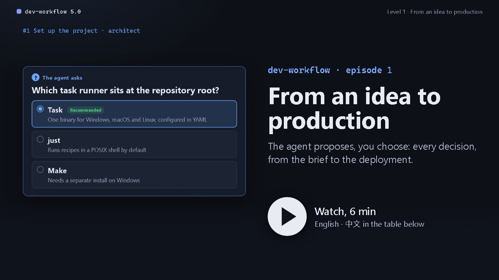
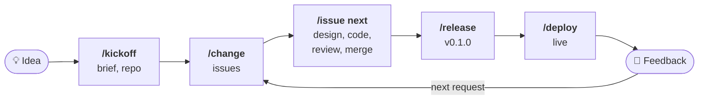

# dev-workflow

[](https://github.com/juanchaopan/dev-workflow/releases/latest)
[](LICENSE)

**Build a whole project on your own, the way a good team would.**

dev-workflow is a Claude Code plugin that gives you the team: an architect, a designer, developers, reviewers and a release manager. You make the decisions. It does the work, one issue at a time, from the first idea to production.

[](https://github.com/juanchaopan/dev-workflow/releases/download/v5.0.0/dev-workflow-5-ep1-en-landscape.mp4)

<sub>Episode 1 in English. [中文版](https://github.com/juanchaopan/dev-workflow/releases/download/v5.0.0/dev-workflow-5-ep1-zh-landscape.mp4), and all four episodes, [below](#learn-more).</sub>

## How a project goes



Six commands, one loop. Here is a booking site for a barbershop going from a sentence to production, and around again:

```text
/kickoff            "A booking site for my barbershop"    →  brief, repository, labels
/change             "Set up the project"                  →  #1 Set up the project
/issue next         the architecture, in 13 questions     →  project, CI, CD, staging
/change             "Customers book online"               →  #2 Book a time, #3 Staff view
/issue next  (×2)   screens you approve, code, tests      →  #2, #3 reviewed and merged
/release                                                  →  0.1.0
/deploy production                                        →  live
/change             "Let customers cancel a booking"      →  #4, #5 … and around again
```

Every turn of the loop works the same way. A bug becomes a `fix` issue whose first commit is a test that fails. An open question, such as which SMS provider to use, becomes a `spike` that tries the options before anyone builds on them. A change that needs new structure gets a `refactor` issue first, which must leave every test passing.

## The team it gives you

| On a real team | In dev-workflow |
|---|---|
| **Product owner**: decides what and why | **You.** Every question comes with options, a recommendation and the costs. Nothing you have not answered is written. |
| **Architect** | Settles the stack, the structure, the checks and tests, and where it runs, and records each decision in `.docs/` |
| **Designer** | Draws every screen as a prototype and shows it to you as images before any code |
| **DevOps** | Sets up the repository, CI, CD, branch rules and secrets, and shows the monthly cost before creating anything |
| **Developers** | Fresh agents build each issue in small units, with a test for every acceptance criterion |
| **Reviewers** | AI code, simplification and security reviews on every pull request; you approve the risky ones |
| **Release manager** | Picks the version from what was merged, writes the changelog, and deploys through your platform's jobs |

Every issue moves through the same five steps, **kickoff → architect → design → scaffold → implement**, and each step may change only its own files. CI enforces this, so code cannot quietly rewrite the requirements. Secrets never pass through the conversation.

It works for any language and stack, on GitHub, GitLab, Azure DevOps, Bitbucket Cloud, Gitea and Forgejo.

## Get started

In Claude Code:

```
/plugin marketplace add juanchaopan/dev-workflow
/plugin install dev-workflow@dev-workflow
```

Start a new session and type `/kickoff`. You also need git and your code platform's command-line tool, such as `gh`. The agent tells you which one and how to sign in.

The plugin adds about 2,000 tokens to a session. A command's instructions are read only when you run it.

## Update

```
claude plugin marketplace update dev-workflow
claude plugin update dev-workflow@dev-workflow
```

Then start a new session. Your projects do not change by themselves: the next command uses the new version, and an issue in progress picks up where it stopped. To bring something new from an update into a project, ask for it with `/change`. 5.0 is a complete rewrite and does not convert projects from earlier versions.

## Commands

| Command | What it does |
|---|---|
| `/kickoff` | Starts a project: the brief, the code platform, the repository |
| `/change` | Turns what you say into issues, each with a type, a size and acceptance criteria |
| `/issue next` | Picks the next issue and works it to done; `/issue <n>` works a given one |
| `/release` | Releases the next version |
| `/deploy <target>` | Deploys to staging or production |
| `/perf-test <target>` | Runs the load tests against a deployment |

## Learn more

Four short episodes follow the barbershop project:

| Episode | English | 中文 |
|---|---|---|
| 1. From an idea to production | [watch](https://github.com/juanchaopan/dev-workflow/releases/download/v5.0.0/dev-workflow-5-ep1-en-landscape.mp4) (5:56) | [观看](https://github.com/juanchaopan/dev-workflow/releases/download/v5.0.0/dev-workflow-5-ep1-zh-landscape.mp4) (5:31) |
| 2. When requirements change | [watch](https://github.com/juanchaopan/dev-workflow/releases/download/v5.0.0/dev-workflow-5-ep2-en-landscape.mp4) (3:27) | [观看](https://github.com/juanchaopan/dev-workflow/releases/download/v5.0.0/dev-workflow-5-ep2-zh-landscape.mp4) (3:10) |
| 3. Quality and review | [watch](https://github.com/juanchaopan/dev-workflow/releases/download/v5.0.0/dev-workflow-5-ep3-en-landscape.mp4) (4:33) | [观看](https://github.com/juanchaopan/dev-workflow/releases/download/v5.0.0/dev-workflow-5-ep3-zh-landscape.mp4) (4:17) |
| 4. Production grade | [watch](https://github.com/juanchaopan/dev-workflow/releases/download/v5.0.0/dev-workflow-5-ep4-en-landscape.mp4) (4:13) | [观看](https://github.com/juanchaopan/dev-workflow/releases/download/v5.0.0/dev-workflow-5-ep4-zh-landscape.mp4) (3:50) |

Portrait versions and subtitle files are in the [5.0.0 release](https://github.com/juanchaopan/dev-workflow/releases/tag/v5.0.0). For everything on one page, see the [poster](docs/poster.png) ([PDF](https://github.com/juanchaopan/dev-workflow/releases/download/v5.0.0/dev-workflow-5-poster.pdf)). The rules every step follows are in [`skills/issue/workflow.md`](skills/issue/workflow.md).

## Feedback

Questions, bugs and ideas are welcome in [Issues](https://github.com/juanchaopan/dev-workflow/issues). If dev-workflow helps you build something, a ⭐ helps others find it.

[MIT License](LICENSE)
