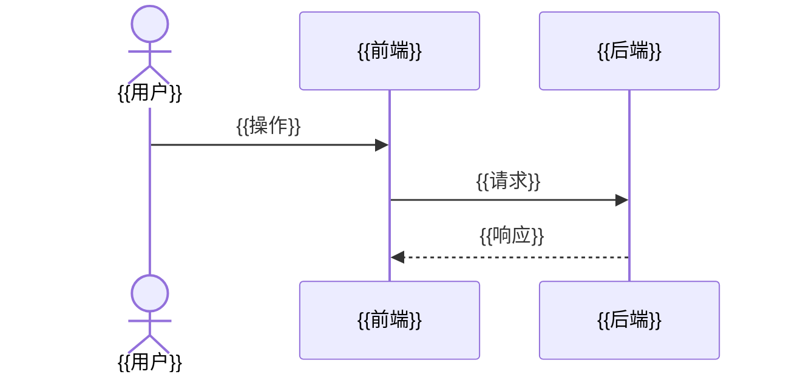

# 架构总览

相关决策见 `docs/adr/`。本文和 ADR 冲突时，以状态为"已接受"的最新 ADR 为准，并尽快修正本文。

## 架构指标

| 指标 | 目标 | 依据 |
|---|---|---|
| {{例如：并发用户}} | {{例如：200}} | {{REQ-xxx 或 vision.md 约束}} |

## 架构风格

{{选定的风格，一两句话说明理由。详见 ADR-0001。}}

## 系统上下文

```mermaid
flowchart LR
  user([{{用户角色}}]) --> system[{{系统名称}}]
  system --> ext[{{外部系统}}]
```

## 分层

| 层 | 职责 | 可以依赖 |
|---|---|---|
| {{层名}} | {{职责}} | {{允许依赖的层}} |

## 组件

```mermaid
flowchart LR
  web[{{前端}}] -->|HTTPS| api[{{后端服务}}]
  api --> db[({{数据库}})]
  api -->|事件| queue[[{{消息队列}}]]
  queue --> worker[{{后台任务}}]
```

| 组件 | 目录 | 技术栈 | 职责 | 拥有的数据 | 对外接口 | 依赖 |
|---|---|---|---|---|---|---|
| {{组件}} | `apps/{{组件}}` | {{技术栈}} | {{职责}} | {{数据}} | {{接口}} | {{依赖}} |

## 关键场景

### {{场景名称}}（REQ-xxx）



## 部署

```mermaid
flowchart TB
  lb[负载均衡] --> api1[{{服务}} 实例 1]
  lb --> api2[{{服务}} 实例 2]
  api1 --> db[({{数据库}}，主备)]
  api2 --> db
```

| 组件 | 环境 | 实例数 | 有无状态 | 扩容方式 | 健康检查 |
|---|---|---|---|---|---|
| {{组件}} | {{生产}} | {{2}} | {{无状态}} | {{按 CPU 水平扩容}} | {{/health}} |

本地开发：`infra/docker-compose.yml` 启动全部组件和依赖。

## 数据

| 数据 | 主人 | 存储 | 一致性 | 备份 |
|---|---|---|---|---|
| {{数据}} | {{组件}} | {{存储}} | {{强一致 / 最终一致}} | {{方式和频率}} |

数据库结构变更方式：{{例如：Flyway 迁移脚本，先加后删，不停机}}

## 横切关注点

| 方面 | 做法 |
|---|---|
| 认证授权 | {{做法}} |
| 配置和密钥 | {{做法}} |
| 日志、指标、追踪 | {{做法}} |
| 错误处理 | {{做法}} |
| 限流和幂等 | {{做法}} |
| API 版本 | {{做法}} |
| 功能开关 | {{做法}} |

## 故障场景

| 故障 | 用户看到什么 | 系统怎么处理 | 怎么恢复 |
|---|---|---|---|
| {{组件或依赖}}挂了 | {{现象}} | {{降级或重试}} | {{恢复方式}} |

## 演进

- {{现在不做但已预留的扩展点，以及触发条件，例如：日活超过 1 万时把 worker 拆成独立服务}}
