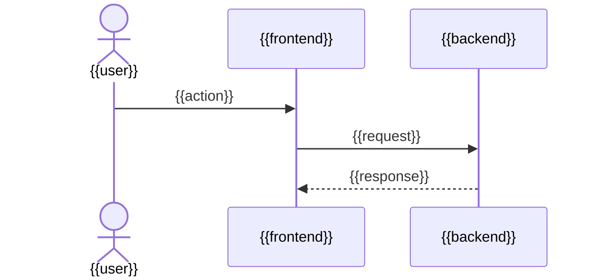

# Architecture overview

Related decisions are in `docs/adr/`. When this document conflicts with an ADR, the latest ADR with the status "Accepted" wins, and this document is corrected promptly.

## Architecture metrics

| Metric | Target | Basis |
|---|---|---|
| {{e.g. concurrent users}} | {{e.g. 200}} | {{REQ-xxx or a constraint in vision.md}} |

## Architecture style

{{The chosen style and a sentence or two on why. See ADR-0001.}}

## System context

```mermaid
flowchart LR
  user([{{user role}}]) --> system[{{system name}}]
  system --> ext[{{external system}}]
```

## Layers

| Layer | Responsibility | May depend on |
|---|---|---|
| {{layer}} | {{responsibility}} | {{allowed layers}} |

## Components

```mermaid
flowchart LR
  web[{{frontend}}] -->|HTTPS| api[{{backend service}}]
  api --> db[({{database}})]
  api -->|events| queue[[{{message queue}}]]
  queue --> worker[{{background worker}}]
```

| Component | Directory | Stack | Responsibility | Owned data | External interface | Depends on |
|---|---|---|---|---|---|---|
| {{component}} | `apps/{{component}}` | {{stack}} | {{responsibility}} | {{data}} | {{interface}} | {{dependencies}} |

## Key scenarios

### {{scenario}} (REQ-xxx)



## Deployment

```mermaid
flowchart TB
  lb[Load balancer] --> api1[{{service}} instance 1]
  lb --> api2[{{service}} instance 2]
  api1 --> db[({{database}}, primary and standby)]
  api2 --> db
```

| Component | Environment | Instances | Stateful | Scaling | Health check |
|---|---|---|---|---|---|
| {{component}} | {{production}} | {{2}} | {{stateless}} | {{horizontal, by CPU}} | {{/health}} |

Local development: `infra/docker-compose.yml` starts every component and dependency.

## Data

| Data | Owner | Storage | Consistency | Backup |
|---|---|---|---|---|
| {{data}} | {{component}} | {{storage}} | {{strong / eventual}} | {{method and frequency}} |

Schema changes: {{e.g. Flyway migration scripts, add before drop, no downtime}}

## Cross-cutting concerns

| Concern | Approach |
|---|---|
| Authentication and authorization | {{approach}} |
| Configuration and secrets | {{approach}} |
| Logs, metrics, tracing | {{approach}} |
| Error handling | {{approach}} |
| Rate limiting and idempotency | {{approach}} |
| API versioning | {{approach}} |
| Feature flags | {{approach}} |

## Failure scenarios

| Failure | What the user sees | How the system responds | Recovery |
|---|---|---|---|
| {{component or dependency}} is down | {{symptom}} | {{degradation or retry}} | {{recovery}} |

## Evolution

- {{extension points not built now but left room for, and their triggers, e.g. split the worker into its own service above 10,000 daily active users}}
